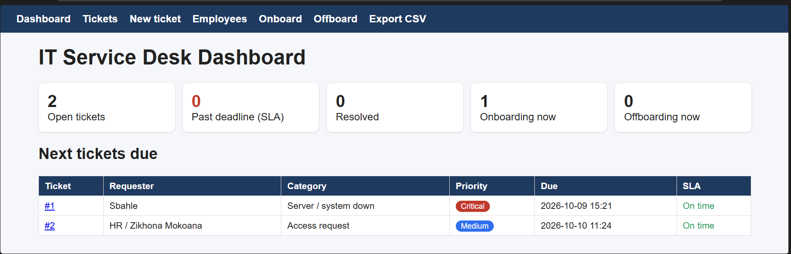
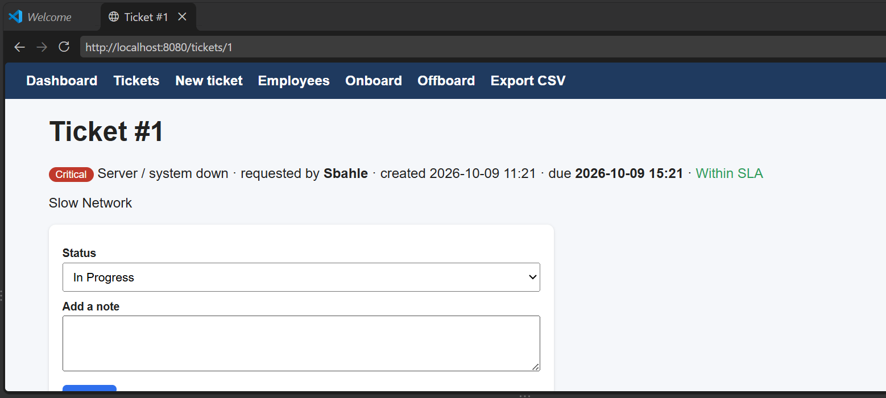
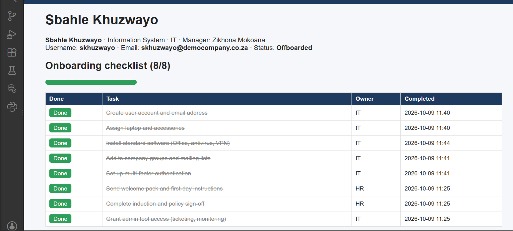

# IT Service Desk Ticketing and Employee Onboarding/Offboarding Management System (SDLM)

A small web application that makes three manual IT tasks simple: **logging support tickets**, **onboarding new employees** and **offboarding leavers**.

> **In plain words:** instead of writing tickets in emails or spreadsheets and typing the same checklist for every new starter, you fill in one short form and the system does the rest.

## The problem it solves
In many small IT teams, tickets arrive by phone, WhatsApp and email, deadlines are guessed, and every new starter or leaver needs the same long checklist typed out by hand. Steps get forgotten (for example, a leaver's account stays active). This tool removes that manual work.

## What it does
**Tickets**
- Anyone logs a ticket with a short form: name, category, description
- **Priority and deadline are set automatically** from the category (for example "Server down" = Critical, 4 hours; "Password reset" = Low, 72 hours). This is called an SLA (service level agreement)
- Shows which tickets are **overdue**
- Technicians change the status (Open, In Progress, Resolved, Closed) and add notes
- Export all tickets to CSV (opens in Excel)

**Onboarding (new employee)**
- One form: name, department, job title, manager, start date
- Automatically creates the **username** and **email address**, and a strong one-time **temporary password** (shown once, never saved)
- Automatically creates the full **checklist**: account, laptop, software, groups, multi-factor authentication, induction, plus extra steps for the department
- Automatically opens a setup **ticket**

**Offboarding (leaver)**
- Pick the employee and their last day
- Automatically creates the **leaver checklist**: disable account, revoke access, back up files, forward email, collect equipment, remove from groups, HR sign-off
- Automatically opens a high-priority **ticket**

When every checklist task is ticked, the employee's status updates by itself (Onboarding > Active, Offboarding > Offboarded).

## Screenshots
**Dashboard**



**A ticket with its deadline and status**



**Onboarding checklist**



## How to run it
You need Python 3 only (no extra packages).
```
python servicedesk.py
```
Then open **http://localhost:8080** in your browser. Stop with Ctrl+C.

Run the tests: `python -m unittest discover -s tests -v`

Edit `config.json` to change the company name, email domain, deadlines (SLA hours), ticket categories and the onboarding/offboarding checklists. No code changes needed.

## Project files
| File | What it is for |
|---|---|
| `servicedesk.py` | the whole application: database, ticket and lifecycle logic, web pages |
| `config.json` | categories, deadlines and checklists you can edit |
| `tests/test_servicedesk.py` | automated tests (8 tests) |

## Design decisions
- **SQLite** database: one file, no server to install
- **Python standard library only**: nothing to install, easy to run anywhere
- Temporary passwords are **shown once and never stored**
- Checklists live in a **config file**, so an IT manager can change them without a programmer

## Limitations (honest)
- It **tracks the work**, it does not create accounts. It is not connected to Active Directory, Microsoft 365 or any real system. A real version would call those systems' APIs
- No login screen, so it is meant for a trusted internal network or a demo
- Deadlines count calendar hours, not business hours
- No email notifications yet

## Possible next steps
Login and roles (technician vs. HR), email notifications, business-hours SLAs, connecting to Microsoft Graph API to really create accounts, and a Docker setup.

**Author:** Sbahle Teddy Khuzwayo - [LinkedIn](https://www.linkedin.com/in/sbahle-khuzwayob7a58423b) - sbahlekhuz2000@gmail.com
